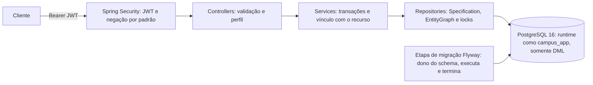

# Campus API

API REST de gestão acadêmica com autenticação JWT, autorização por perfil **e** por vínculo com o recurso,
PostgreSQL e migrações versionadas (Flyway).

**Escopo funcional**: alunos, professores, disciplinas, matrículas, notas, média, histórico e gestão das contas de
acesso. Não inclui turmas, períodos letivos, financeiro ou outros módulos.

Documentação complementar:
[arquitetura](docs/arquitetura.md) · [operação local, DBeaver, boot e backup](docs/operacao-local.md) ·
[contas legadas](docs/contas-legadas.md)

## Sumário

- [Stack](#stack)
- [Arquitetura](#arquitetura)
- [Regras acadêmicas](#regras-acadêmicas)
- [Autenticação e ciclo de tokens](#autenticação-e-ciclo-de-tokens)
- [Matriz de permissões](#matriz-de-permissões)
- [Requisitos e variáveis](#requisitos-e-variáveis)
- [Execução local](#execução-local)
- [Execução com Docker](#execução-com-docker)
- [Primeiro administrador](#primeiro-administrador)
- [Swagger / OpenAPI](#swagger--openapi)
- [PostgreSQL, DBeaver e inicialização automática](#postgresql-dbeaver-e-inicialização-automática)
- [Migrações](#migrações)
- [Backup e recuperação](#backup-e-recuperação)
- [Contas legadas](#contas-legadas)
- [Exemplos de requisições](#exemplos-de-requisições)
- [Erros, paginação e validação](#erros-paginação-e-validação)
- [Mudanças de contrato](#mudanças-de-contrato)
- [Testes, smoke test e CI](#testes-smoke-test-e-ci)
- [Solução de problemas](#solução-de-problemas)
- [Segurança: decisões e limitações](#segurança-decisões-e-limitações)

---

## Stack

| Componente | Versão efetiva |
|---|---|
| Java | 21 (LTS) |
| Spring Boot | 4.0.5 (Spring Framework 7, Spring Security 7.0.4, Spring Data JPA 4.0) |
| Hibernate ORM | 7.2.7 |
| Jackson | 3.1 |
| PostgreSQL | 16 |
| Flyway | 11.14 + `flyway-database-postgresql` |
| springdoc-openapi | 3.0.3 (OpenAPI 3.1, Swagger UI) |
| Testcontainers | 2.0.4 |
| Maven | 3.9.14 via `./mvnw` |

## Arquitetura

Monólito organizado por domínio; cada domínio tem controller, service, repository, entidade e DTOs.



```
aluno/ professor/ disciplina/ matricula/   domínio acadêmico
usuario/    contas, perfis, política de senha        auth/       login, refresh, logout, troca de senha
seguranca/  JWT, filtro, controle de acesso, 429     config/     OpenAPI, bootstrap, checagem de configuração
comum/      paginação, normalização, correlation id  exception/  ProblemDetail (RFC 9457)
```

Responsabilidades, fluxo detalhado de uma requisição autenticada e decisões: [docs/arquitetura.md](docs/arquitetura.md).

## Regras acadêmicas

- **Matrícula** (`MatriculaAluno`) é a única fonte do vínculo aluno-disciplina; também as rotas
  `/disciplinas/{id}/alunos/{alunoId}` usam o mesmo serviço.
- Criação somente por ADMIN; aluno e disciplina devem existir (404); status inicial sempre `MATRICULADO`.
- **Uma matrícula por aluno e disciplina**: verificação prévia + constraint `uk_matriculas_aluno_disciplina`.
  Em requisições concorrentes, uma vence (201) e as demais recebem `409 MATRICULA_DUPLICADA`.
- **Trancamento**: somente ADMIN e somente a partir de `MATRICULADO`; `TRANCADO` é final e bloqueia notas
  (`409 TRANSICAO_INVALIDA`).
- **Notas**: `nota1` e `nota2` de 0 a 10, até 2 casas (`numeric(4,2)`). `PATCH` parcial: campo ausente ou `null`
  mantém a nota atual; corpo sem nenhuma nota → 400.
- **Média**: `(nota1 + nota2) / 2`, exata (ex.: 6,995), só com as duas notas. **≥ 7,0 → APROVADO**, abaixo →
  REPROVADO; notas incompletas mantêm `MATRICULADO`. Correções autorizadas recalculam o status nos dois sentidos.
- Lançamentos simultâneos na mesma matrícula são serializados (`SELECT … FOR UPDATE`), sem perda de atualização.
- **Cancelamento** só para matrícula `MATRICULADO` sem notas; demais casos → 409 (preserva histórico).
- **Histórico**: aluno inexistente → 404; aluno sem matrículas → 200 com `disciplinas: []`.
- **Exclusões** com vínculos (matrículas, contas, disciplinas do professor) → `409 REGISTRO_EM_USO`; FKs
  `ON DELETE RESTRICT`, sem cascatas sobre dados acadêmicos.

## Autenticação e ciclo de tokens

| Token | Formato | Validade | Armazenamento no servidor |
|---|---|---|---|
| Access token | JWT HS256 (`iss`, `aud`, `sub`, `iat`, `exp`, `jti`, `ver`) | `JWT_ACCESS_TOKEN_TTL` (15 min) | nenhum (stateless) |
| Refresh token | opaco, 256 bits | `JWT_REFRESH_TOKEN_TTL` (7 dias) por token | somente SHA-256 + família + versão das credenciais |

- **Validação do access token**: assinatura e algoritmo (apenas HS256; `alg: none` rejeitado), expiração (tolerância
  de 30 s), emissor e audiência. Depois, o usuário é recarregado do banco: precisa estar ativo e com
  `versao_credenciais` igual à claim `ver`. O payload não contém login, nome, e-mail nem perfil.
- **Login**: `POST /auth/login` → access + refresh. Login inexistente, senha errada e conta inativa respondem igual
  (`401 CREDENCIAIS_INVALIDAS`, mesmo custo de BCrypt).
- **Renovação**: `POST /auth/refresh` consome o refresh token (uso único) e emite um novo par na mesma família.
- **Reutilização**: apresentar um refresh token já consumido revoga **toda a família** (`REUTILIZACAO_DETECTADA`).
- **Renovações simultâneas** com o mesmo refresh token: política **estrita**. O servidor não distingue duas abas
  legítimas de um token copiado por terceiros; a primeira recebe 200 e a segunda é tratada como reutilização (401),
  o que encerra a sessão, inclusive o refresh token recém-emitido. **Contrato para o cliente**: mantenha no máximo
  uma renovação em andamento por sessão e compartilhe o resultado entre as requisições que aguardam (ex.: uma
  única `Promise` de refresh no frontend). O access token já emitido continua válido até expirar.
- **Logout**: `POST /auth/logout` (público, sempre 204) revoga a família do refresh token informado:

  | Token informado | Efeito |
  |---|---|
  | atual | sessão revogada |
  | já rotacionado | sessão revogada (inclusive o sucessor ainda ativo) |
  | já revogado ou expirado | nenhum efeito adicional |
  | inexistente | nenhum efeito (resposta idêntica) |

  **O access token continua válido até expirar** (no máximo `JWT_ACCESS_TOKEN_TTL`); o logout não o invalida.
- **Invalidação imediata** de access e refresh tokens: troca de senha (`PUT /auth/senha`, exige a senha atual),
  redefinição pelo ADMIN, desativação e mudança de perfil/vínculo. Esses eventos incrementam
  `versao_credenciais`; um refresh emitido em paralelo também é rejeitado.
- **Limite de tentativas**: após 5 falhas por login+IP ou 20 por IP em 15 min → `429 MUITAS_TENTATIVAS` com
  `Retry-After`, mesmo com a senha correta. A troca de senha tem limite próprio por conta.
- `Authorization` é ignorado nas três rotas públicas de `/auth`, para que um access token vencido não impeça
  renovação ou logout.

## Matriz de permissões

| Operação | ADMIN | PROFESSOR | ALUNO |
|---|---|---|---|
| Gestão de usuários (`/usuarios/**`) | ✅ | ❌ | ❌ |
| `GET /auth/me`, `PUT /auth/senha` | ✅ | ✅ | ✅ |
| Listar alunos / professores | ✅ | ❌ | ❌ |
| `GET /alunos/{id}` | ✅ | ❌ | o próprio |
| `GET /professores/{id}` | ✅ | o próprio | ❌ |
| Criar/alterar/excluir alunos, professores, disciplinas | ✅ | ❌ | ❌ |
| Associar/remover professor da disciplina | ✅ | ❌ | ❌ |
| `GET /disciplinas`, `GET /disciplinas/{id}` | todas | as que leciona | as que cursa |
| `GET /disciplinas/professor/{id}` | ✅ | o próprio id | ❌ |
| Criar/cancelar matrícula, trancar | ✅ | ❌ | ❌ |
| `GET /matriculas`, `GET /matriculas/{id}` | todas | das suas disciplinas | as próprias |
| Lançar/corrigir notas | ✅ | nas suas disciplinas | ❌ |
| Histórico do aluno | ✅ | ❌ | o próprio |

Perfil verificado por `@PreAuthorize`; vínculo verificado nos serviços. Trocar UUIDs em URL, corpo ou filtros não
dá acesso a dados alheios; listagens aplicam o escopo na consulta, antes da paginação. Professores veem apenas id,
nome e matrícula dos alunos. Contas: ALUNO exige `alunoId`; PROFESSOR exige `professorId`; ADMIN não tem vínculo;
cada aluno/professor tem no máximo uma conta; não há cadastro público; o ADMIN não altera nem desativa a própria
conta e sempre resta um ADMIN ativo.

## Requisitos e variáveis

Requisitos: **JDK 21**, **Docker** com Compose v2 (PostgreSQL local, imagem da API e testes com Testcontainers),
`openssl` e `ss` (script de configuração), `curl` e `jq` (smoke test).

| Variável | Finalidade | Obrigatória | Ambiente |
|---|---|---|---|
| `POSTGRES_DB` / `POSTGRES_USER` / `POSTGRES_PASSWORD` | banco e administrador (dono do schema, usado pelo Flyway) | sim (compose) | compose, dev |
| `POSTGRES_PORT` | porta publicada em 127.0.0.1 | não (5433) | compose, dev |
| `APP_DB_USER` / `APP_DB_PASSWORD` | usuário de runtime somente-DML | sim (compose) | compose, dev |
| `DB_URL` / `DB_USERNAME` / `DB_PASSWORD` | conexão da API | sim fora de dev | prod |
| `SPRING_FLYWAY_ENABLED` | migração dentro do processo da API (`false` no compose, que usa a etapa `migracao`) | não (`true`) | prod |
| `SPRING_FLYWAY_USER` / `SPRING_FLYWAY_PASSWORD` | credencial do dono do schema, só se a API migrar no próprio processo | não | dev (via `.env`) |
| `JWT_SECRET` | chave HMAC Base64 ≥ 256 bits (`openssl rand -base64 32`) | sim fora de dev | todos |
| `JWT_ISSUER` / `JWT_AUDIENCE` | emissor/audiência (`campus-api` / `campus-api-clients`) | não | todos |
| `JWT_ACCESS_TOKEN_TTL` / `JWT_REFRESH_TOKEN_TTL` / `JWT_CLOCK_SKEW` | validades (`PT15M` / `P7D` / `PT30S`) | não | todos |
| `LOGIN_MAX_TENTATIVAS_CREDENCIAL` / `LOGIN_MAX_TENTATIVAS_IP` / `LOGIN_JANELA` | limite de login (5 / 20 / `PT15M`) | não | todos |
| `BOOTSTRAP_ADMIN_LOGIN` / `BOOTSTRAP_ADMIN_PASSWORD` | primeiro administrador | não | todos |
| `CORS_ALLOWED_ORIGINS` | origens permitidas, sem curingas | não (vazio) | todos |
| `SWAGGER_ENABLED` | expõe Swagger/OpenAPI | não (`false`; `true` em dev e no compose local) | todos |
| `FORWARD_HEADERS_STRATEGY` | `native` atrás de proxy confiável | não (`none`) | prod |
| `FLYWAY_BASELINE_ON_MIGRATE` | adoção única de banco legado | não (`false`) | todos |
| `APP_PORT` / `SERVER_PORT` | porta publicada / porta HTTP interna | não (8080) | compose / todos |

`.env.example` documenta as variáveis; `./scripts/configurar-ambiente-local.sh` gera o `.env` real (permissão 600,
ignorado pelo Git) com segredos aleatórios. Sem `DB_*` ou `JWT_SECRET` fora do perfil dev, a aplicação **não
inicia** e informa: `Configuração obrigatória ausente: DB_URL, DB_USERNAME, DB_PASSWORD, JWT_SECRET`.

Perfis: `dev` (ativado por `./mvnw spring-boot:run`; lê o `.env`; Swagger ligado; chave JWT efêmera se ausente),
`test` (Testcontainers) e `prod` (imagem Docker). O jar não tem perfil padrão.

**Credenciais do banco por processo**

| Processo | Usuário | Recebe a senha do dono do schema? |
|---|---|---|
| API no Docker Compose (`app`) | `campus_app` (somente DML) | não (`SPRING_FLYWAY_ENABLED=false`) |
| Etapa de migração (`migracao`, Flyway CLI 11.14.1) | `campus_user` (dono do schema) | sim; executa e termina |
| API em dev (`./mvnw spring-boot:run`) | `campus_app` em runtime | sim: o Flyway roda no próprio processo com o dono do schema lido do `.env` (conveniência local). Alternativa: `docker compose --profile app run --rm migracao` e `SPRING_FLYWAY_ENABLED=false ./mvnw spring-boot:run` |

Fora do Compose, em produção, execute as migrações como etapa separada (Flyway CLI com o dono do schema) e inicie a
API com `SPRING_FLYWAY_ENABLED=false` e apenas a credencial do usuário de runtime.

## Execução local

```bash
./scripts/configurar-ambiente-local.sh     # uma vez
docker compose up -d postgres
./scripts/db-provisionar.sh                # necessário apenas para volumes criados por versões anteriores
./mvnw spring-boot:run                     # perfil dev; API em http://localhost:8080
```

## Execução com Docker

```bash
./scripts/configurar-ambiente-local.sh     # uma vez
docker compose --profile app up -d --build # postgres → migracao (Flyway, termina) → app
curl -s http://127.0.0.1:8080/actuator/health
```

Serviços: `postgres` (`restart: unless-stopped`), `migracao` (Flyway CLI com o dono do schema; executa as migrações
pendentes e encerra) e `app` (só inicia se a migração terminar com sucesso; conecta como `campus_app`).

Imagem multi-stage com bases fixadas (`eclipse-temurin:21.0.9_10-jdk/jre-noble`), usuário sem privilégios
(uid 10001), healthcheck em `/actuator/health/readiness`, sistema de arquivos somente leitura,
`no-new-privileges` e sem capabilities. Funciona com e sem BuildKit. Portas apenas em 127.0.0.1.

## Primeiro administrador

Não há senha padrão nem cadastro público. Com `BOOTSTRAP_ADMIN_LOGIN` e `BOOTSTRAP_ADMIN_PASSWORD` definidos
(o script de configuração gera ambos no `.env`), a aplicação cria o ADMIN **somente se não existir nenhum ADMIN**.
Em inicializações seguintes nada é feito: o bootstrap não recria contas, não altera senhas e não reativa usuários;
se o login já pertencer a uma conta não-ADMIN, a inicialização é interrompida. Após o primeiro login, troque a
senha (`PUT /auth/senha`) e remova as duas variáveis do `.env`. **A API não obriga essa troca**: não existe flag de
"senha temporária" nem bloqueio até a troca; trata-se de um passo operacional.

## Swagger / OpenAPI

| URL (local) | Conteúdo |
|---|---|
| <http://localhost:8080/swagger-ui.html> | Swagger UI (redireciona para `/swagger-ui/index.html`) |
| <http://localhost:8080/v3/api-docs> | documento OpenAPI 3.1 (JSON) |

Disponível quando `SWAGGER_ENABLED=true` (padrão no perfil dev e no compose local); desligado por padrão em
produção e, quando desligado, as rotas exigem autenticação. Conteúdo: 6 tags por domínio, 38 operações, DTOs com
validações e exemplos fictícios, paginação/filtros/ordenação, respostas `application/problem+json`, perfis por
operação e esquema HTTP Bearer; login, refresh e logout aparecem sem cadeado.

Fluxo: em **Autenticação** execute `POST /auth/login` (*Try it out*), copie `accessToken`, clique em **Authorize**,
cole apenas o token (sem `Bearer`) e execute as operações protegidas. Validado em navegador: sem autorização → 401;
com token de ADMIN → 200; com token de ALUNO em `/usuarios` → 403.

## PostgreSQL, DBeaver e inicialização automática

| Campo DBeaver | Valor |
|---|---|
| Driver | PostgreSQL |
| Host | `127.0.0.1` |
| Porta | `POSTGRES_PORT` do `.env` (nesta máquina: `5435`) |
| Database | `campus_api` |
| Usuário | `campus_app` (dados) ou `campus_user` (administração) |
| Senha | `APP_DB_PASSWORD` / `POSTGRES_PASSWORD` no `.env` |
| SSL | desabilitado (`sslmode=disable`) |
| JDBC | `jdbc:postgresql://127.0.0.1:5435/campus_api` |

A API dentro do Compose usa `jdbc:postgresql://postgres:5432/campus_api`. A conexão pelo DBeaver com esses dados
foi validada pelo usuário nesta máquina. O contêiner `campus-api-db` tem
`restart: unless-stopped` e healthcheck; o `docker.service` está habilitado no boot nesta máquina. Detalhes,
comandos de operação e o que depende de um reboot real: [docs/operacao-local.md](docs/operacao-local.md).

## Migrações

| Versão | Conteúdo |
|---|---|
| V1 | schema legado equivalente ao gerado pelo Hibernate (idempotente) |
| V2 | pré-verificação de conflitos, normalização, constraints nomeadas, notas `numeric(4,2)`, reconciliação `alunos_disciplinas` → `matriculas` |
| V3 | `usuarios`, `refresh_tokens`; preserva `usuarios` pré-existente como `usuarios_legado` |
| V4 | tabelas de controle/auditoria somente leitura para papéis que não sejam o dono |

- **Onde rodam**: no Compose, no serviço `migracao` antes da API; no perfil dev, dentro do processo. O Hibernate
  apenas valida o schema (`ddl-auto=validate`).
- **Banco novo**: V1–V4 aplicadas na primeira execução.
- **Banco já migrado**: `Schema "public" is up to date`; nada é reaplicado.
- **Banco legado** (criado com `ddl-auto=update`): faça backup (`./scripts/db-backup.sh pre-flyway`) e execute
  **uma vez** `FLYWAY_BASELINE_ON_MIGRATE=true docker compose --profile app run --rm migracao`. O baseline é
  registrado na **versão 0**, abaixo de V1, então V1–V4 são executadas integralmente (a V1 é idempotente e não
  recria tabelas existentes). Sem o opt-in, o Flyway recusa um schema não vazio sem histórico.
- Somente leitura: `docker compose --profile app run --rm --no-deps migracao validate` (ou `info`).
- Cada migração roda em uma transação (DDL transacional do PostgreSQL); a V2 bloqueia as tabelas durante a
  pré-verificação. Uma falha não deixa alterações parciais.
- Migrações aplicadas não devem ser editadas (checksum); correções entram como nova versão.

O que a V2 faz com dados existentes: converte notas sem arredondar, normaliza e-mails/identificadores, cria
matrícula `MATRICULADO` sem notas (`origem = MIGRACAO_LEGADO`) para cada vínculo N:N sem matrícula e preserva
`alunos_disciplinas_legado`. Conflitos abortam com uma lista, por exemplo:

```
Migração V2 abortada: dados legados exigem correção manual antes da consolidação:
- 1 par(es) aluno/disciplina com matrículas duplicadas
- 1 matrícula(s) com nota fora de 0..10 ou com mais de 2 casas decimais
```

Consultas de diagnóstico:

```sql
SELECT aluno_id, disciplina_id, array_agg(id) FROM matriculas GROUP BY 1, 2 HAVING count(*) > 1;
SELECT * FROM matriculas m WHERE aluno_id IS NULL OR disciplina_id IS NULL OR status IS NULL
   OR status NOT IN ('MATRICULADO','APROVADO','REPROVADO','TRANCADO')
   OR NOT EXISTS (SELECT 1 FROM alunos a WHERE a.id = m.aluno_id)
   OR NOT EXISTS (SELECT 1 FROM disciplinas d WHERE d.id = m.disciplina_id);
SELECT * FROM matriculas WHERE nota1 NOT BETWEEN 0 AND 10 OR nota2 NOT BETWEEN 0 AND 10
   OR nota1::numeric <> round(nota1::numeric, 2) OR nota2::numeric <> round(nota2::numeric, 2)
   OR (status IN ('APROVADO','REPROVADO') AND (nota1 IS NULL OR nota2 IS NULL))
   OR (status = 'MATRICULADO' AND nota1 IS NOT NULL AND nota2 IS NOT NULL);
SELECT lower(btrim(email)), array_agg(id) FROM alunos GROUP BY 1 HAVING count(*) > 1;
SELECT upper(btrim(codigo)), array_agg(id) FROM disciplinas GROUP BY 1 HAVING count(*) > 1;
```

Banco local desta máquina: adotado em 13/11/2026 após backup verificado; V1–V4 aplicadas; contagens preservadas.

## Backup e recuperação

`./scripts/db-backup.sh [rotulo]` gera dump, roles (sem senhas), SHA-256 e só considera o backup válido após
restaurá-lo em um contêiner temporário com contagens idênticas. Restauração passo a passo:
[docs/operacao-local.md#6-backup-e-recuperação](docs/operacao-local.md#6-backup-e-recuperação).

## Contas legadas

O banco local tinha uma tabela `usuarios` externa ao código (7 contas `USER`, BCrypt sem prefixo), preservada como
`usuarios_legado`. Elas **não** foram migradas automaticamente: `USER` não corresponde a um perfil atual, não há
vínculo comprovado com aluno/professor e os hashes não têm compatibilidade comprovada. As contas antigas não
autenticam na API; o administrador as recria individualmente: [docs/contas-legadas.md](docs/contas-legadas.md).

## Exemplos de requisições

```bash
API=http://localhost:8080
TOKEN=$(curl -s -X POST $API/auth/login -H 'Content-Type: application/json' \
  -d '{"login":"admin","senha":"<sua-senha>"}' | jq -r .accessToken)
H=(-H "Authorization: Bearer $TOKEN" -H 'Content-Type: application/json')

PROF=$(curl -s -X POST $API/professores "${H[@]}" \
  -d '{"nome":"Carlos Mendes","email":"carlos.mendes@campus.edu","registro":"PROF-001","especialidade":"Matemática"}' | jq -r .id)
ALUNO=$(curl -s -X POST $API/alunos "${H[@]}" \
  -d '{"nome":"Lucas Oliveira","email":"Lucas.Oliveira@Campus.edu","matricula":"2026001"}' | jq -r .id)
DISC=$(curl -s -X POST $API/disciplinas "${H[@]}" \
  -d "{\"nome\":\"Cálculo I\",\"codigo\":\"MAT-101\",\"cargaHoraria\":80,\"professorId\":\"$PROF\"}" | jq -r .id)
curl -s -X POST $API/usuarios "${H[@]}" \
  -d "{\"login\":\"lucas.oliveira\",\"senha\":\"<senha-individual>\",\"perfil\":\"ALUNO\",\"alunoId\":\"$ALUNO\"}"
MAT=$(curl -s -X POST $API/matriculas "${H[@]}" -d "{\"alunoId\":\"$ALUNO\",\"disciplinaId\":\"$DISC\"}" | jq -r .id)
curl -s -X PATCH $API/matriculas/atualizar-notas/$MAT "${H[@]}" -d '{"nota1":8.0,"nota2":7.5}'
# → {"nota1":8.00,"nota2":7.50,"media":7.75,"status":"APROVADO", ...}
curl -s "$API/matriculas?disciplinaId=$DISC&sort=aluno.nome,asc&size=50" "${H[@]}"
curl -s $API/matriculas/emitir-historico/$ALUNO "${H[@]}"
```

Resposta de matrícula (`POST /matriculas`, 201 com `Location`):

```json
{
  "id": "…", "aluno": {"id": "…", "nome": "Lucas Oliveira", "matricula": "2026001"},
  "disciplina": {"id": "…", "nome": "Cálculo I", "codigo": "MAT-101", "professorId": "…", "nomeProfessor": "Carlos Mendes"},
  "nota1": null, "nota2": null, "media": null, "status": "MATRICULADO",
  "criadoEm": "2026-11-13T18:20:00.123", "atualizadoEm": "2026-11-13T18:20:00.123"
}
```

## Erros, paginação e validação

Erros em `application/problem+json`:

```json
{"type": "urn:campus-api:problema:validacao", "title": "Requisição inválida", "status": 400,
 "detail": "Um ou mais campos são inválidos", "instance": "/alunos", "codigo": "VALIDACAO",
 "correlationId": "1f4c7c1e-…", "timestamp": "2026-11-13T21:20:00Z",
 "erros": [{"campo": "email", "mensagem": "deve ser um endereço de e-mail bem formado"}]}
```

Códigos: `VALIDACAO`, `JSON_INVALIDO`, `PARAMETRO_INVALIDO`, `RECURSO_NAO_ENCONTRADO`, `ROTA_NAO_ENCONTRADA`,
`METODO_NAO_SUPORTADO`, `TIPO_MIDIA_NAO_SUPORTADO`, `CONFLITO`, `MATRICULA_DUPLICADA`, `VINCULO_EXISTENTE`,
`REGISTRO_EM_USO`, `TRANSICAO_INVALIDA`, `CONFLITO_CONCORRENCIA`, `OPERACAO_NAO_PERMITIDA`, `NAO_AUTENTICADO`,
`TOKEN_INVALIDO`, `CREDENCIAIS_INVALIDAS`, `SENHA_ATUAL_INCORRETA`, `MUITAS_TENTATIVAS`, `ACESSO_NEGADO`,
`ERRO_INTERNO`. Nunca são retornados stack traces, SQL, nomes de constraint, senhas ou tokens; toda resposta traz
`X-Correlation-Id`, também presente nos logs.

Listagens: `{"conteudo": [...], "pagina": 0, "tamanho": 20, "totalElementos": 42, "totalPaginas": 3}`;
`size` máximo 100; `sort` validado por endpoint, com `id` como desempate. Textos normalizados (espaços; e-mail e
login em minúsculas; matrícula, registro e código em maiúsculas); unicidade garantida também no banco; campos JSON
desconhecidos → 400.

## Mudanças de contrato

| Antes | Depois |
|---|---|
| Rotas públicas | Bearer JWT + perfil e vínculo |
| Entidades JPA nas respostas | DTOs; `Disciplina` sem `alunos`, `Professor` sem `disciplinas` |
| Listagens como array | envelope paginado (`conteudo`) |
| `POST /disciplinas/{id}/alunos/{alunoId}` → 200 com disciplina | 201 com a matrícula |
| `DELETE /disciplinas/{id}/alunos/{alunoId}` sempre removia | 204 só sem notas; senão 409 |
| `PATCH /matriculas/atualizar-notas/{id}` → 204 | 200 com a matrícula |
| Transições inválidas → 400 | 409 `TRANSICAO_INVALIDA` |
| Histórico de aluno sem matrículas → 404 | 200 com lista vazia |
| Notas `double` livres; matrícula duplicada aceita | 0–10 com 2 casas; 409 |
| `PUT /disciplinas/{id}` sem carga horária | `cargaHoraria` obrigatória; `professorId` ausente mantém o atual |
| Erros `{status, erro, mensagem}`; 500 com `ex.getMessage()` | ProblemDetail com `codigo`/`correlationId` |
| Campos desconhecidos ignorados; exclusões com vínculo → 500 | 400; 409 |

## Testes, smoke test e CI

```bash
./mvnw verify      # JDK 21 + Docker
```

Suítes de integração sobre PostgreSQL real (Testcontainers), com a aplicação conectada como usuário somente-DML:
autenticação (tokens adulterados/expirados/`alg:none`/emissor/audiência, rotação, reutilização, renovação
concorrente, logout em todos os estados, troca de senha, desativação, mudança de perfil, 429), gestão de usuários e
escalada de privilégio, autorização por recurso e escopo de listagens, matrículas e notas (concorrência, limites,
média 7,0 e 6,995, correções, histórico), cadastros e contrato de erros, bootstrap do administrador, migração de
banco legado (DDL real do Hibernate, conflitos, `usuarios` pré-existente) e fluxo completo por HTTP; mais testes
unitários de regras.

Smoke test contra uma instância em execução (cria dados de exemplo; use em banco descartável):

```bash
BASE_URL=http://localhost:8080 ADMIN_LOGIN=admin ADMIN_PASSWORD='<senha>' ./scripts/smoke-test.sh
```

CI (`.github/workflows/ci.yml`): `./mvnw -B verify` com Temurin 21 e Docker do runner, seguido do build da imagem.

## Solução de problemas

Tabela completa em [docs/operacao-local.md#7-solução-de-problemas](docs/operacao-local.md#7-solução-de-problemas).
Os casos mais comuns: `.env` ausente (rode o script de configuração), porta ocupada (ajuste `POSTGRES_PORT`), senha
recusada em volume antigo (`./scripts/db-provisionar.sh`), banco legado sem histórico do Flyway (backup + opt-in de
baseline) e JDK diferente de 21 (erro do Lombok ao compilar).

## Segurança: decisões e limitações

- **CSRF desabilitado** deliberadamente: credenciais só no cabeçalho `Authorization` e no corpo JSON, sem cookies
  ou sessão, então o navegador não as envia automaticamente. Se o refresh token passar a usar cookie, a proteção
  CSRF deve voltar.
- **CORS**: só origens listadas, sem curingas e sem credenciais de navegador.
- **Negação por padrão**: rotas não mapeadas exigem autenticação e são negadas; actuator expõe apenas `health`
  sem detalhes; Swagger desligado por padrão fora do dev.
- **Senhas**: BCrypt (via `DelegatingPasswordEncoder`), 10–64 caracteres e ≤ 72 bytes, com letras e dígitos;
  nunca registradas em log nem devolvidas. Tokens também não são registrados.
- **Banco**: a API usa `campus_app` (somente DML: sem DDL, sem TRUNCATE, sem escrita no histórico do Flyway nem nas
  tabelas `*_legado`); no Compose, a senha do dono do schema só existe no contêiner efêmero de migração.
- **Limitações**:
  - Limite de tentativas **em memória**, por instância. Adequado ao desenho atual (uma instância); com réplicas,
    exigiria armazenamento compartilhado. Atrás de proxy configure `FORWARD_HEADERS_STRATEGY=native`; sem isso,
    todos os clientes compartilham o IP do proxy. Atacantes com muitos IPs não bloqueiam a conta (proteção contra
    bloqueio de contas legítimas), e rajadas simultâneas podem exceder o limite em poucas tentativas.
  - Access token válido até expirar após logout (≤ 15 min por padrão).
  - Renovações simultâneas do mesmo refresh token encerram a sessão (política estrita acima).
  - Rehash de senha no login (se o custo do BCrypt mudar) pode gerar 409 em logins simultâneos do mesmo usuário.
  - Sem turmas/períodos: uma matrícula por aluno e disciplina, sem rematrícula; trancamento é final.
  - Exclusão de usuários não é oferecida (use desativação).
  - Não há troca obrigatória de senha no primeiro acesso (senhas iniciais e temporárias dependem de orientação).
  - No perfil dev, a senha do dono do schema fica disponível ao processo da API (migração local).

## Pendências operacionais

- Confirmar, após um reboot real, que `campus-api-db` voltou `Up (healthy)` (configuração verificada por inspeção).
- Acompanhar a primeira execução da CI no GitHub (workflow ainda não executado lá).
- Recriar as contas legadas conforme [docs/contas-legadas.md](docs/contas-legadas.md).
- Trocar a senha do administrador inicial e remover `BOOTSTRAP_ADMIN_*` do `.env` quando conveniente.

Projeto acadêmico — UNIESP, disciplina de Backend Java/Spring Boot.
