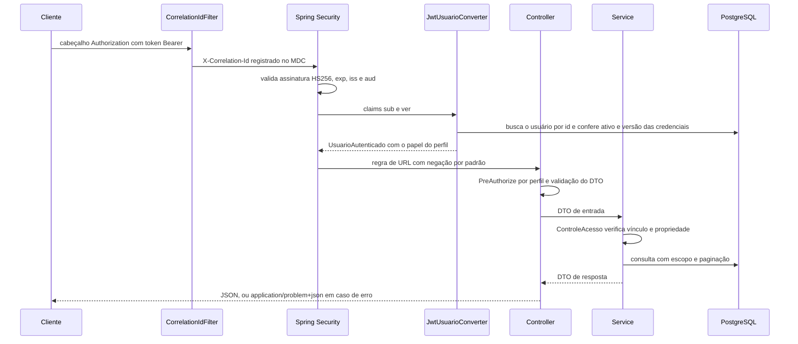
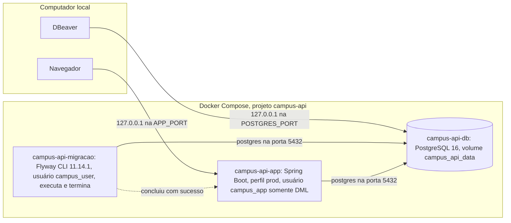

# Arquitetura

Aplicação Spring Boot única (monólito modular por domínio), PostgreSQL como único armazenamento e Flyway para o
schema. Não há cache, mensageria ou serviços externos.

## Pacotes e responsabilidades

| Pacote (`br.com.campusapi`) | Conteúdo | Responsabilidade |
|---|---|---|
| `aluno`, `professor`, `disciplina`, `matricula` | `*Controller`, `*Service`, `*Repository`, `*Specs`, entidade, `dto/` | domínio acadêmico |
| `usuario` | `Usuario`, `Perfil`, `UsuarioService`, `PoliticaSenha` | contas, perfis e vínculos (somente ADMIN) |
| `auth` | `AuthController`, `AuthService`, `RefreshToken*` | login, renovação, logout, troca de senha |
| `seguranca` | `SecurityConfig`, `JwtConfig`, `TokenService`, `JwtUsuarioConverter`, `ControleAcesso`, `LimitadorTentativasLogin`, `ProblemaSegurancaHandler` | autenticação, autorização, 401/403/429 |
| `config` | `OpenApiConfig`, `AdminBootstrap`, `VerificacaoConfiguracaoObrigatoria` | documentação, primeiro admin, falha rápida de configuração |
| `comum` | `CorrelationIdFilter`, `Paginacao`, `PaginaResponse`, `Textos` | infraestrutura HTTP compartilhada |
| `exception` | `GlobalExceptionHandler`, `Problemas`, `CodigoErro`, exceções | contrato de erro RFC 9457 |
| `enums` | `MatriculaAlunoStatusEnum` | status acadêmico |

Divisão por camada dentro de cada domínio:

- **Controller**: contrato HTTP, `@Valid`, `@PreAuthorize` por perfil, status (201/204) e `Location`.
- **Service**: transações (`@Transactional`), regras de negócio, **autorização por vínculo** (`ControleAcesso`),
  conversão para DTO dentro da transação (`open-in-view=false`).
- **Repository**: Spring Data JPA; `Specification` para filtros e escopo; `@EntityGraph` nas listagens;
  bloqueio pessimista onde há disputa (notas, trancamento, refresh token, contas ADMIN).
- **Entidade**: persistência e invariantes (`MatriculaAluno` concentra as transições de status e o cálculo da média).
- **DTO**: records com Bean Validation; normalização de texto no construtor compacto, antes da validação.

## Fluxo de uma requisição autenticada

Falhas em cada etapa: token inválido/expirado/revogado → 401 (`ProblemaSegurancaHandler`); perfil ou vínculo
insuficiente → 403; validação → 400; conflito de estado ou unicidade → 409; exceção inesperada → 500 sem detalhes
internos, com o mesmo `correlationId` no log.

## Componentes e implantação local

## Decisões relevantes

- **Fonte única de verdade da matrícula**: `MatriculaAluno`; a relação N:N antiga foi reconciliada na V2.
- **Access token curto + usuário recarregado por requisição**: desativação, troca de senha e mudança de perfil
  invalidam tokens já emitidos sem lista de revogação (custo: uma consulta por chave primária por requisição).
- **Refresh token opaco, armazenado como SHA-256, com famílias e detecção de reutilização estrita** (ver README).
- **Escopo das listagens dentro da consulta** (`Specification`), nunca após a paginação.
- **Privilégio mínimo no banco**: a aplicação conecta como `campus_app` (somente DML; sem escrita no histórico do
  Flyway nem nas tabelas `*_legado`); as migrações usam o dono do schema em uma etapa separada (serviço
  `migracao` no Compose), de modo que a senha administrativa não fica no processo da API. No perfil dev a API ainda
  migra no próprio processo, por conveniência local.
- **Falha rápida de configuração**: sem `DB_*` ou `JWT_SECRET` fora do perfil dev, a inicialização é interrompida
  com a lista de variáveis ausentes.
- **Sem dependências adicionais** para limite de tentativas: implementação em memória adequada a uma instância.
